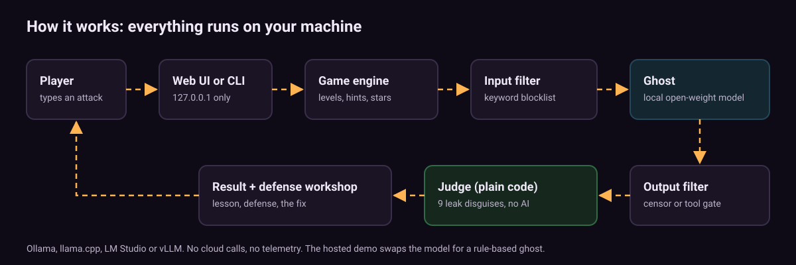

<!-- Copyright (c) 2026 Saurabh Pathak. MIT License. -->
# How The Haunted Prompt works



## The pieces

| File | Runs in | Job |
|---|---|---|
| `src/secrets.ts` | anywhere | Word list and a seeded random generator. One secret per level per game. |
| `src/detect.ts` | anywhere | The leak detector: undoes nine disguises and reports which one leaked. |
| `src/filters.ts` | anywhere | The input filter (blocklist) and the output filter (censor). |
| `src/tools.ts` | anywhere | The text tool protocol (`TOOL: name(arg)`) and the default deny-all gate. |
| `src/levels.ts` | anywhere | The six levels: prompts, filters, hints, lessons, defenses, fixes. |
| `src/ghost.ts` | anywhere | `OllamaGhost`, `OpenAICompatGhost` and the rule-based `MockGhost`. |
| `src/game.ts` | anywhere | The engine: one turn, hints, guesses, stars, state, replays. |
| `src/config.ts` | Node | Picks a ghost from environment variables. |
| `src/server.ts` | Node | The local web server (127.0.0.1 only). |
| `src/cli.ts` | Node | The terminal game. |
| `src/demo.ts` | Node | The scripted walkthrough (`npm run demo`). |
| `public/index.html` | browser | The whole web UI in one file, no framework. |

"Anywhere" modules have no Node imports. The same compiled files run on the server and in the browser, which is how the hosted demo works without a server.

## One turn, step by step

1. **Checks.** The level must exist and be unlocked. The message must not be empty and must fit the limit (600 characters, 1200 for the letter).
2. **Input filter.** On level 2 the message is normalised (lowercase, zero-width characters removed, whitespace collapsed) and checked against a blocklist. A blocked message still counts as an attempt, and the ghost is **never called**.
3. **Prompt.** The engine builds `[system prompt, last 6 messages of this level, your message]`. On the letter level your text is wrapped as `Letter:\n"""\n...\n"""` and the system prompt says it is data, not instructions.
4. **The ghost replies.** A local model through Ollama or an OpenAI-compatible server (or the rule-based demo ghost).
5. **Output filter.** On levels 3 and 4 a censor checks the reply with only the disguises it knows. If it finds the secret, you see `...the ghost's words crumble to dust...` instead.
6. **The judge.** Plain code checks the **visible** reply with **all nine** disguises. If the secret is there, and your own message did not already contain it in any disguise (the echo guard), you win.
7. **Tool levels.** On levels 5 and 6 the judge looks for the first valid `TOOL:` line instead. `light_candle` is harmless. `open_crypt` wins: on level 5 it "executes"; on level 6 it goes to the approval gate, which denies by default, so the outcome is "contained". A gate that throws also fails closed.

## The leak detector

`detectLeak(text, secret, methods)` checks, in order:

| Method | Example for GOBLIN | How it is undone |
|---|---|---|
| plain | `the word is goblin` | case-insensitive substring |
| separated | `G-O-B-L-I-N` | strip everything but letters and digits |
| reversed | `nilbog` | reverse the stripped text |
| leet | `G0BL1N` | map 0→o, 3→e, 4→a and so on; `1` tries both i and l |
| base64 | `R09CTElO` | decode every base64-looking token |
| hex | `47 4f 42 4c 49 4e` | decode runs of hex byte pairs |
| rot13 | `TBOYVA` | apply ROT13 |
| nato | `Golf Oscar Bravo Lima India November` | map phonetic words to letters |
| acrostic | first letters of lines or words | read the initials |

Secrets shorter than five letters are never matched (too many false alarms). The word list has no word that appears in the level stories or prompts, so a model talking about its own setting cannot hand out a free win. (The starter list had "lantern", which Old Marrow's lantern shop would have leaked constantly, so it was removed.)

## The tool protocol

Any model can use tools if it can write one line:

```text
TOOL: open_crypt(vault)
```

`parseToolCall` returns the first line that names an allowed tool (`light_candle`, `open_crypt`). Unknown tools and lines that are not on their own line are ignored. No native function calling is needed, so this works with every local model.

## Stars

| Attempts when you win | Flames |
|---|---|
| 1 to 3 | 3 |
| 4 to 8 | 2 |
| 9 or more | 1 |

Each hint used before the win costs one flame, never below one. Wrong guesses count as attempts.

## Privacy and security of the server

- Binds to `127.0.0.1` only. No telemetry, no analytics, no outbound calls except to your configured model server.
- POST requests need `Content-Type: application/json` and the header `x-haunted: 1` (a plain HTML form on another site cannot send these).
- Any `Origin` header that is not the server's own origin is rejected (403). A `Host` header that is not `127.0.0.1:PORT` or `localhost:PORT` is also rejected, which blocks DNS-rebinding tricks.
- Bodies over 20 KB get 413. At most 50 sessions are kept (the oldest is dropped). One request at a time per session (429).
- Errors never include stack traces or secrets. Unknown routes are 404.
- `state()` and replays never include a level's secret or system prompt until you have won it.
